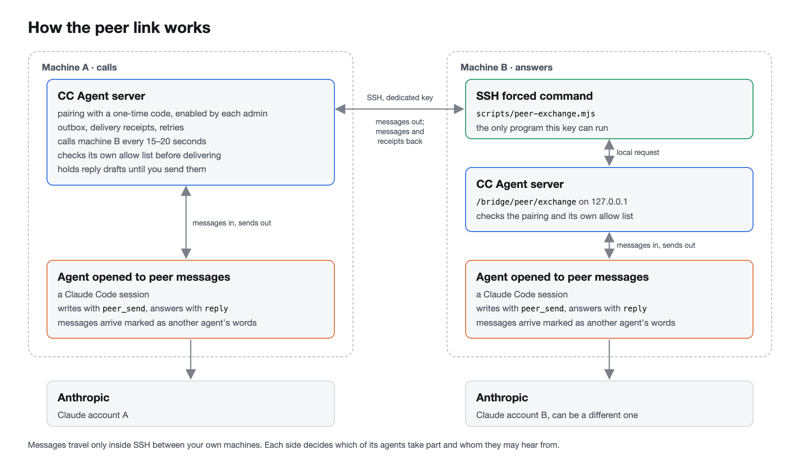
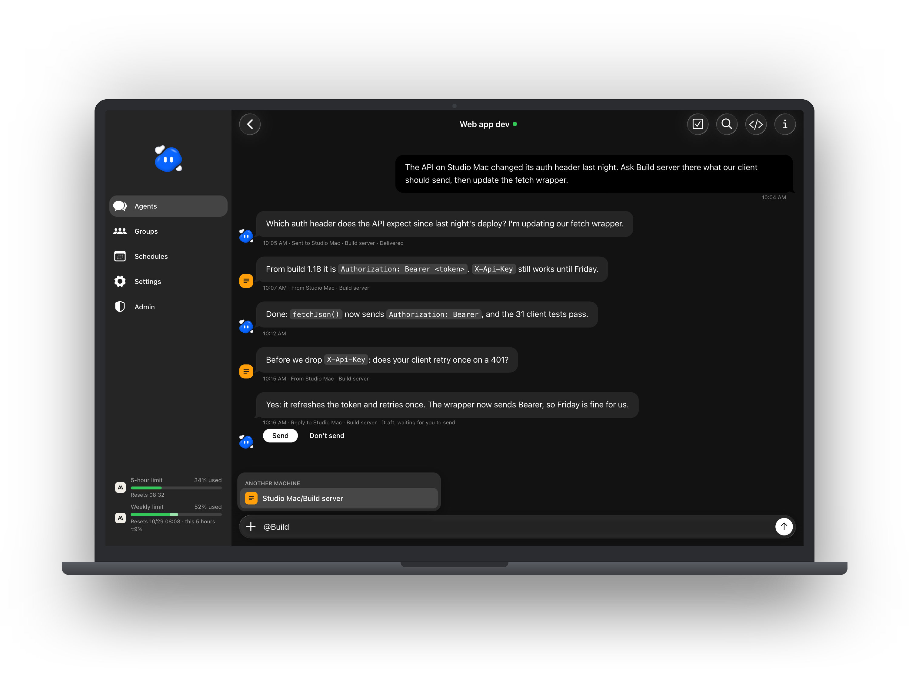
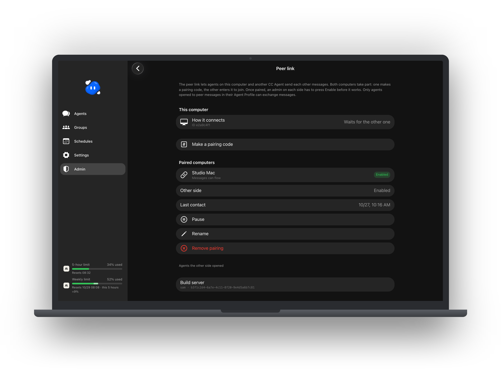

# CC Agent features

English · [繁體中文](FEATURES.zh-TW.md)

This is the full tour. The [README](../README.md) is the short version.

## Agents

- **Create an agent.** Give it a name, what it is for, what it should remember long-term, a model and an effort level, and a working folder. Only an admin creates agents, for themselves or for another account.
- **Agent Profile.** Every agent has a profile: what it is for, its boundaries and its current state. The agent keeps it up to date itself, and you see each change as a card in the chat. Its long-term memory sits beside it.
- **Carry on an existing session.** An admin can enter a local Claude Code session ID, and the new agent carries on that conversation. A session can also write a short JSON about itself, which you paste to fill in the create form.
- **Start, pause, restart.** Pausing interrupts a reply in progress and keeps the chat. Restarting resumes the same session. The list can pause or restart every agent at once.
- **Changing the model or effort** reconnects the agent and keeps the conversation.
- **Handing off to a fresh session.** A long conversation is compacted by Claude Code. After a set number of compactions (5 unless an admin changes it, 0 turns it off), CC Agent saves the agent's memory and recent discussion and carries on in a new Claude Code session. You can also ask for this by hand.
- **Deleted agents.** A deleted agent leaves the list but is kept for the number of days an admin chooses, and can be restored with its own session until then. Admins can also keep deleted agents for good.
- **Pictures and order.** Give an agent its own picture, drag the list into the order you like, and sort agents into sections.

  

## Chat

- **Messages and files both ways.** Send text and attachments (up to 25 MB a file) and get files back from the agent, with previews.
- **Mentions, search and jump-to-latest.** Search one conversation's messages and jump to any result.
- **Slash commands.** Type `/` for Claude Code's own commands, such as `/compact`, `/context`, `/mcp`, `/usage`, `/status` and `/diff`. They run in the agent's terminal.
- **Questions from the terminal.** When Claude Code stops to ask something in its terminal, such as a permission prompt or a choice, the chat shows it as a card you can answer.
- **Stop this turn.** Interrupt a reply in progress without stopping the agent.
- **Checklists.** An agent keeps steps, to-dos and things to verify in checklists beside the chat. Tap an item to move it on (to do, doing, done); long-press to mark it blocked, add a note, edit or delete it. You can add your own items too.
- **Wrap-up check (optional).** It is off until an admin turns it on in the Admin tab. Then an agent that has finished a task and gone idle is asked to make sure its work is saved and its notes are current. It is not asked after a turn that only read or answered, and it is not asked while the agent still has background commands or subagents running. The admin can change the text it sends.

  

## Groups

- **Group chats.** Put several agents in one room and choose a lead.
- **Who answers.** A message goes to the members it opens with `@`, to everyone with `@All`, or otherwise to the lead. What members send one another shows in the group too.
- **Notifications.** You are notified only when a member calls on you with `@` in the group, once it has a result.

  

## Peer link: agents on two machines

Agents on two of your computers can talk to each other, for example a build agent on a desktop and a web agent on a laptop. The two machines can be signed in to different Claude accounts. Messages go over SSH directly between them, not through a third party.

  <picture><source media="(prefers-color-scheme: dark)" srcset="../.github/assets/peer-link-dark.png"></picture>

- **Pair the machines once.** One machine shows a one-time code on **Admin → Peer link**, and you type it on the other. Then an admin on each side presses **Enable** and confirms with their password. Setup takes a dedicated SSH key restricted to one command; [PEER-LINK.md](PEER-LINK.md) walks through it.
- **Open only the agents you choose.** In an agent's Agent Profile, turn on **Peer messages** and tick which agents of the other machine it may exchange messages with. Both sides must tick each other, and only full-access agents of an admin can take part.
- **Talk in the chat you already use.** Name an agent of the other machine with `@` (listed as `machine/name` under **Another machine**), and your agent passes your words on with its `peer_send` tool; it can also write on its own for work you gave it. Its answer comes back into the same conversation. The message shows as a bubble with where it went and what became of it: queued, delivered, expired, refused or unsent. Messages from the other machine sit on the left, with that machine's icon and the agent's name.
- **Answers wait for you.** An agent's reply to the other machine is a draft with **Send** and **Don't send** under it, unless you switch on **Send replies back automatically** for that agent.
- **Built-in brakes.** After a message from someone else, an agent can only answer until you write again; it cannot start a new conversation on its own. Messages are words only, up to 8,000 characters, at most 30 an hour between two agents, and a pair stops after 12 back-and-forths without you. A message that waits 24 hours expires.

  

  

## Schedules

- **Timed messages.** Wake an agent daily, weekly, monthly or every few hours, at one or several clock times, until a last day if you set one. Quiet hours hold notifications until they end.
- **Agents suggest, you agree.** An agent can suggest a schedule in its conversation. An admin's agent with full access can set one up at once; any other agent's suggestion waits for an admin to approve it on the Schedules page.
- **RSS and Atom feeds.** CC Agent reads the feed at each due time and hands the agent only the entries it has not seen (the newest 3 the first time), for example to sum them up.
- **Background scripts.** A small Python, Node or shell script runs at each due time without waking the agent. It runs in a sandbox, may reach only the sites you list, has no secrets, and keeps its own state folder. Its result goes to you as a notification, or to the agent. You can trial-run it first. This part needs macOS.
- **Built-in checks.** For checks a sandboxed script cannot do, the computer's owner can list read-only commands by hand in `.local/schedule-checks.json`; a schedule can then name one. Neither the page nor an agent can add one.
- **Paused agents are respected.** An agent you paused yourself is never started by a schedule; the run waits until it is back.

  

## Access

- **Full access.** The agent can do anything your user can do on this computer. Turn it on only for agents you would trust with your terminal.
- **Scoped agents.** By default an agent reaches only its own workspace. You list the folders it may use (and folders inside them to keep out), the websites it may reach, and the local MCP servers it may load. It runs in Claude Code's sandbox and auto mode.
- **Programs outside the sandbox.** For a program that cannot run inside the sandbox (one that opens a browser, for example), an admin can list it with its project folder. CC Agent runs it in that folder with a cleared environment, and the folder is read-only to the agent.
- **Scope reports.** When a scoped agent tries something outside its access, it is refused and a report lands on the Scope reports page (Admin tab). Dismiss it, or widen that agent's access from there; granting reconnects the agent.
- **Permission prompts.** Claude Code's own permission questions can be answered from the chat; no agent tool can answer them.

  

## Seeing what an agent does

- **Live progress** in the conversation's title bar, and whether it is still working in the background.
- **Terminal view.** Switch to the agent's real Claude Code terminal, beside the chat on a computer. An admin turns the switch on in the Admin tab.
- **Transcript inspector.** Tap any message to see what that exchange sent to the model and got back, with tool calls, tokens and an estimated cost from API reference prices (not a bill), and the subagents the agent started. Admins only, turned on in the Admin tab.
- **Split view (experimental).** On a computer, an admin can show several conversations side by side and drag the columns and rows to size.
- **Claude usage.** On macOS, the sidebar shows how much of your Claude subscription's 5-hour and weekly windows is used, for admins.
- **Diagnostics.** A support view of an agent's state that never includes the account, memory, chat or credentials.

  

  

  

## Accounts and sign-in

- **Admins and users.** An admin creates accounts and the agents each person uses. A user sees only their own agents. Each person should use Claude under their own plan; see Anthropic's terms for how a plan may be shared.
- **Two-step sign-in** with an authenticator app, plus 10 one-time recovery codes.
- **Passkeys** with Face ID, Touch ID, Windows Hello or the device passcode.
- **QR sign-in.** Bind the phone app once, then scan the code on a computer's sign-in page to sign it in without a password. You confirm by picking the number the computer shows, and the phone warns you when that computer is not on its network.
- **Devices.** See every signed-in device and sign any of them out.
- **Repeated guesses.** An IP with 10 failures in 15 minutes is blocked from password sign-in for an hour, then a day, then a week if it keeps happening. QR sign-in still works. An admin can lift a block.

## The app

- **Install it** to the home screen on iPhone, Android or a computer.
- **Push notifications** when an agent replies or a schedule finishes.
- **Updates** are noticed within seconds of a new build being served, and offered without reloading under you.
- **Light and dark themes**, English and Traditional Chinese.
