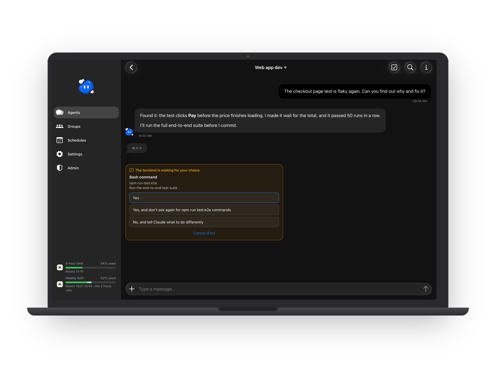
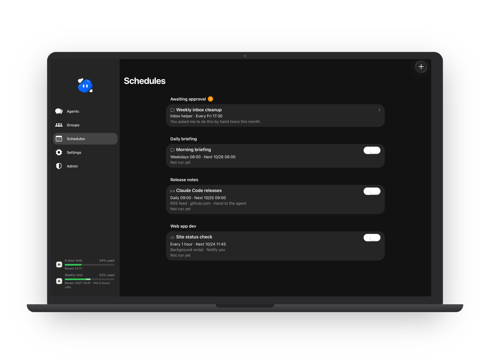
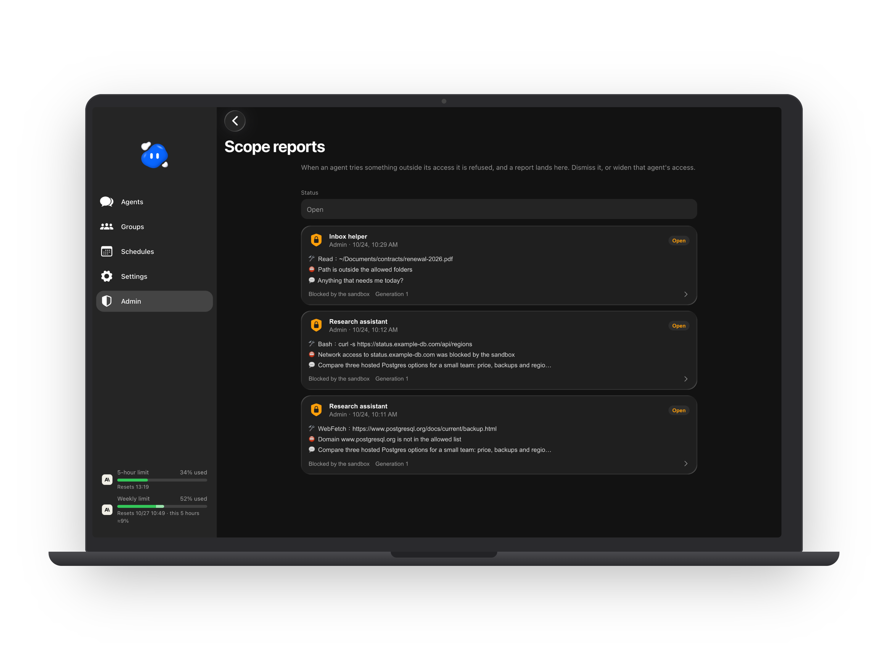
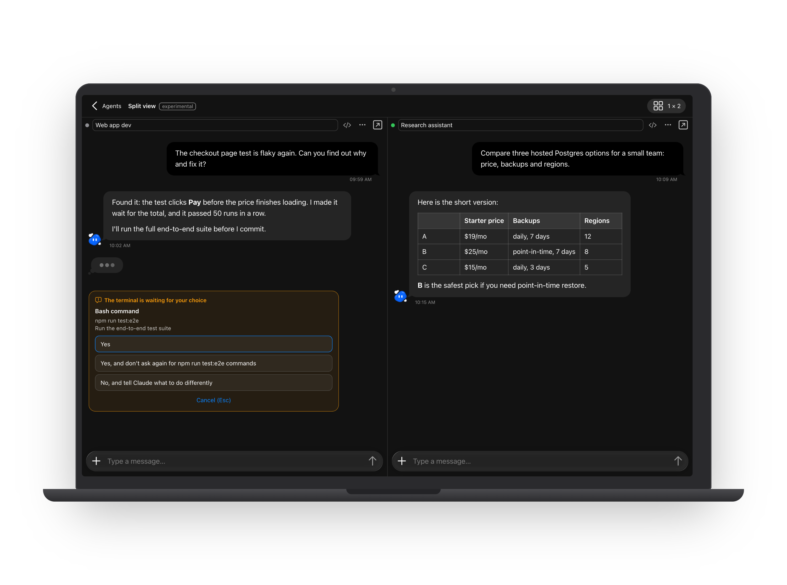

# CC Agent 功能說明

[English](FEATURES.md) · 繁體中文

這份是完整介紹，[README](../README.zh-TW.md) 是精簡版。

## Agent

- **建立 agent。** 設定名稱、用途、要長久記得的內容、模型與 effort，以及工作資料夾。只有管理員能建立 agent，可以建給自己，也可以建給其他帳號。
- **Agent Profile。** 每個 agent 都有一份 Profile，寫它的用途、邊界和目前狀況。agent 會自己更新，每次更新都會在聊天室出現一張卡片。旁邊還有它的長期記憶。
- **接續既有的 session。** 管理員可以輸入本機 Claude Code 的 session ID，新的 agent 就接著那段對話繼續。也可以請 session 用 JSON 介紹自己，貼進建立表單自動填好。
- **啟動、暫停、重啟。** 暫停會中斷正在回覆的內容，聊天紀錄會保留。重啟會接回同一個 session。清單上也可以一次暫停或重啟全部 agent。
- **換模型或 effort** 時 agent 會重新連線，對話會保留。
- **交接給新的 session。** 對話太長時 Claude Code 會壓縮。壓縮達到設定次數後（預設 5 次，管理員可改，設 0 就關閉），CC Agent 會先保存 agent 的記憶和最近的討論，再換到新的 Claude Code session 繼續。也可以手動交接。
- **刪除的 agent。** 刪除後會從清單移除，但依管理員設定的天數保留，期間可以連同原本的 session 一起救回。管理員也可以設定永不清除。
- **頭像與排序。** 可以幫 agent 換頭像、拖曳調整清單順序，也可以把 agent 分組。

  

## 聊天

- **雙向傳訊息與檔案。** 可以傳文字和附件（每個檔案最大 25 MB），agent 也能回傳檔案，都有預覽。
- **@ 提及、搜尋、跳到最新。** 可以在單一對話裡搜尋訊息，點結果直接跳過去。
- **斜線指令。** 輸入 `/` 就能用 Claude Code 自己的指令，例如 `/compact`、`/context`、`/mcp`、`/usage`、`/status`、`/diff`。這些指令會在 agent 的終端機裡執行。
- **終端機跳出的問題。** Claude Code 在終端機停下來問事情時，例如權限詢問或選擇題，聊天室會出現一張卡片，直接在卡片上回答。
- **中斷這一輪。** 中斷正在回覆的內容，不會停掉 agent。
- **清單。** agent 會把步驟、待辦和要驗證的事放在聊天室旁邊的清單。點一下項目會往下一個狀態走（待辦、進行中、完成）；長按可以標成卡住、加備註、修改或刪除。你也可以自己加項目。
- **收尾檢查（選用）。** 預設關閉，要管理員在管理頁打開。打開後，agent 做完任務、閒下來時，會被提醒確認工作都已保存、筆記都是最新的。只讀資料或只回答問題的那一輪不會提醒，還有背景指令或子代理在跑時也不會提醒。管理員可以改提醒的內容。

  

## 群組

- **群組聊天。** 把幾個 agent 放進同一個聊天室，再指定一位負責人。
- **誰來回答。** 訊息開頭用 `@` 點到的成員會收到；用 `@All` 就是全部成員；都沒點名就交給負責人。成員之間互傳的訊息也會顯示在群組裡。
- **通知。** 只有成員在群組裡用 `@` 叫你、而且已經有結果時，才會通知你。

## 跨機連線

- **兩台電腦的 agent 互傳訊息。** 把兩套 CC Agent 配對起來，就算用不同的 Claude 帳號也可以。兩邊開通的 agent 會經 SSH 互傳訊息。設定方式見 [PEER-LINK.md](PEER-LINK.md)（英文）。
- **誰能說話由你決定。** 管理員逐一開通 agent，並勾選它可以往來的另一台 agent；兩邊都要勾選。
- **回覆先給你看。** 送回另一台的回覆預設是草稿，你按一下才送出；也可以讓某個 agent 自動送回。agent 收到別人的訊息之後，在你再次開口前只能回覆，不能主動發訊。

  

## 排程

- **定時訊息。** 可以每天、每週、每月或每隔幾小時叫醒 agent，時間可以設一個或好幾個，也可以設最後一天。勿擾時段內的通知會等時段結束再送。
- **agent 提議，你同意。** agent 可以在對話中提議排程。管理員的全權限 agent 提議的會立刻生效；其他 agent 提議的，要等管理員在排程頁核准。
- **RSS 與 Atom。** 每次到時間，CC Agent 會自己讀 feed，只把 agent 還沒看過的新文章交給它（第一次給最新 3 篇），例如請它整理摘要。
- **背景腳本。** 到時間就執行一段 Python、Node 或 shell 小腳本，不用叫醒 agent。腳本在沙盒裡執行，只能連到你列出的網站，拿不到任何密鑰，有自己的狀態資料夾。結果可以用通知送給你，或交給 agent 處理。正式使用前可以先試跑。這項功能需要 macOS。
- **內建檢查。** 沙盒腳本做不到的檢查，可以由這台電腦的擁有者手動把唯讀指令列在 `.local/schedule-checks.json`，排程再指定要用哪一個。網頁和 agent 都不能新增。
- **尊重暫停。** 你自己暫停的 agent 不會被排程叫起來，這次執行會等它恢復。

  

## 權限

- **全權限。** agent 能做到你的使用者帳號在這台電腦上能做的任何事。只給你願意交出終端機的 agent。
- **限定權限的 agent。** 預設只能碰自己的工作資料夾。你可以列出它能用的資料夾（以及其中要排除的資料夾）、能連的網站、能載入的本機 MCP。它在 Claude Code 的沙盒與 auto mode 裡執行。
- **沙盒外執行的程式。** 沙盒裡跑不動的程式（例如會開瀏覽器的），管理員可以連同它的專案資料夾一起列出來。CC Agent 會在那個資料夾、用清空的環境執行它，那個資料夾對 agent 是唯讀的。
- **範圍報告單。** 限定權限的 agent 想做超出範圍的事時會被擋下，並在管理頁的「範圍報告單」開一張報告單。管理員可以忽略，或直接從報告單放寬那個 agent 的權限；放寬後 agent 會重新連線。
- **權限詢問。** Claude Code 自己的權限詢問可以在聊天室回答，agent 的工具不能代為回答。

  

## 看得到 agent 在做什麼

- **即時進度** 顯示在對話的標題列，也看得到它是不是還在背景工作。
- **終端機檢視。** 切換到 agent 真正的 Claude Code 終端機；在電腦上可以和聊天室並排。開關要由管理員在管理頁打開。
- **Transcript 檢視。** 點任何一則訊息，就能看那一輪送給模型什麼、拿回什麼，包括工具呼叫、token、依 API 參考價估算的費用（不是實際帳單），以及 agent 開過的子代理。只有管理員能用，要在管理頁打開。
- **多欄並排（實驗中）。** 在電腦上，管理員可以並排顯示好幾個對話，拖曳調整欄寬和列高。
- **Claude 用量。** 在 macOS 上，側欄會顯示 Claude 訂閱的 5 小時與每週額度用了多少，只有管理員看得到。
- **診斷資訊。** 給技術支援用的 agent 狀態資料，絕不包含帳號、記憶、聊天內容或憑證。

  

  

  

## 帳號與登入

- **管理員與使用者。** 管理員建立帳號，也建立每個人用的 agent。使用者只看得到自己的 agent。每個人都應該用自己的 Claude 方案；方案能怎麼共用，請看 Anthropic 的條款。
- **兩步驟驗證**：用驗證器 App，另外附 10 組一次性救援碼。
- **通行金鑰**：用 Face ID、Touch ID、Windows Hello 或裝置密碼登入。
- **QR 登入。** 手機上的 App 綁定一次之後，掃電腦登入頁上的 QR code，就能不用密碼登入那台電腦。確認時要選電腦上顯示的數字；那台電腦不在手機的網路裡時，手機會提醒你。
- **裝置。** 看得到所有已登入的裝置，任何一台都能登出。
- **防猜密碼。** 同一個 IP 在 15 分鐘內錯 10 次，就會被擋下不能用密碼登入：第一次擋 1 小時，再犯擋 1 天，之後擋 1 週。QR 登入不受影響。管理員可以解除。

## App

- **可以安裝** 到 iPhone、Android 或電腦的主畫面。
- **推播通知**：agent 回覆或排程完成時通知你。
- **更新**：新版本上線後幾秒內就會發現，提示你更新，不會在你打字時重新載入。
- **淺色與深色主題**，英文與繁體中文。
